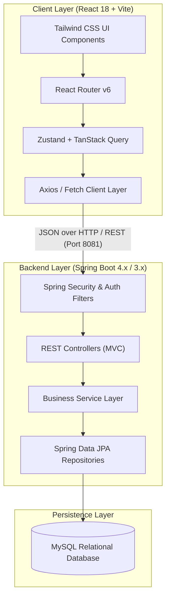

# 🎓 Open LMS

> **A Next-Generation, Full-Stack Learning Management System**  
> Designed and built for seamless academic collaboration, course delivery, assignment workflows, interactive assessments, and modern grading.

[](https://react.dev/)
[](https://vitejs.dev/)
[](https://tailwindcss.com/)
[](https://spring.io/projects/spring-boot)
[](https://www.oracle.com/java/)
[](https://www.mysql.com/)
[](https://zustand-demo.pmnd.rs/)
[](#project-team--academic-credits)

---

## 📌 Table of Contents

- [Overview](#-overview)
- [Project Highlights & Key Features](#-project-highlights--key-features)
  - [Student Workspace](#1-student-workspace)
  - [Instructor & Faculty Workspace](#2-instructor--faculty-workspace)
  - [Collaborative & Shared Tools](#3-collaborative--shared-tools)
- [System Architecture](#-system-architecture)
- [System Design Diagrams](#-system-design-diagrams)
  - [Entity-Relationship Diagram (ERD)](#entity-relationship-diagram-erd)
  - [Level 2 Data Flow Diagram (DFD)](#level-2-data-flow-diagram-dfd)
- [Technology Stack](#-technology-stack)
- [Database Schema & Entities](#-database-schema--entities)
- [Project Directory Structure](#-project-directory-structure)
- [Installation & Getting Started](#-installation--getting-started)
  - [Prerequisites](#prerequisites)
  - [1. Backend Setup (Spring Boot + MySQL)](#1-backend-setup-spring-boot--mysql)
  - [2. Frontend Setup (React + Vite)](#2-frontend-setup-react--vite)
- [REST API Endpoints](#-rest-api-endpoints)
- [Future Roadmap](#-future-roadmap)
- [Project Team & Academic Credits](#-project-team--academic-credits)
- [License](#-license)

---

## 📖 Overview

**Open LMS** is a modern, unified Learning Management System created to bridge the gap between traditional classroom dynamics and digital education. Built as an MCA 3rd Semester Project-Based Learning (PBL) initiative at **Graphic Era Deemed to be University**, Open LMS replaces disjointed tools with an all-in-one platform for curriculum delivery, submission evaluation, real-time progress tracking, and student-teacher interactions.

### Why Open LMS?
- **Unified Academic Workflow:** Combines courses, assignments, timed quizzes, document rubrics, and direct messaging into one cohesive portal.
- **Role-Tailored Portals:** Clean separation of concerns with distinct environments optimized for students and educators.
- **Fast & Responsive Experience:** Built on modern frontend architecture (React 18, Vite, Tailwind CSS) with instantaneous state updates and offline mock fallbacks.
- **Robust Enterprise Backend:** Powered by Spring Boot, Spring Data JPA, and MySQL with entity relationships designed for scale.

---

## 🚀 Project Highlights & Key Features

### 1. Student Workspace

```
Dashboard ──► My Classes ──► Interactive Quizzes ──► Assignments ──► Academic Calendar
```

- **Personalized Student Dashboard:**
  - Weekly progress visualizer and learning streak counter.
  - Quick KPI stats: active classes, pending submissions, and cumulative GPA.
  - "Continue Learning" section highlighting current class materials.
  - Upcoming deadlines banner with smart countdown chips.
- **Course & Classroom Hub:**
  - Interactive course pages displaying modules, syllabus breakdowns, lecture notes, and downloadable assets.
  - Direct instructor contact details and office hour schedules.
- **Interactive Quiz Engine:**
  - Focus-mode quiz interface with question navigation, timer alerts, and multiple-choice question layout.
  - Instant score computation and answer review after submission.
- **Assignment Submission Center:**
  - Deadline tracking with automated status badges (*Pending*, *Submitted*, *Graded*).
  - File attachment support and rubric preview to understand scoring benchmarks before submitting.
- **Academic Calendar:**
  - Centralized schedule showing lectures, exam dates, submission cutoffs, and university events.

---

### 2. Instructor & Faculty Workspace

```
Teaching Overview ──► Course Management ──► Inline Grading ──► Gradebook Matrix
```

- **Faculty Overview Dashboard:**
  - Total enrolled students, active courses, and real-time pending grading counters.
  - Class average indicators and recent submission activity feeds.
- **Course Builder & Curriculum Manager:**
  - Tools to publish and structure course modules, add syllabus items, and distribute resources.
- **Submission Review & Inline Rubric Grading Suite:**
  - Document viewer for reviewing student submissions without external tools.
  - Criteria-based rubric grading with point sliders, preset comments, and overall submission feedback.
- **Dynamic Gradebook:**
  - Tabular grade matrix mapping enrolled students against all coursework and quizzes.
  - Automatic average calculations and grade distribution metrics.

---

### 3. Collaborative & Shared Tools

- **Direct Messages & Discussions:** Threaded conversations between faculty and students for queries, feedback, and assignment clarification.
- **Dual-Role Authentication & Role Switcher:** Fast switching between student and instructor views for demonstration and testing.
- **Resilient Data Layer:** Seamless transition between local mock fixtures (`VITE_USE_MOCKS=true`) for UI development and live Spring Boot REST endpoints (`VITE_USE_MOCKS=false`).

---

## 🏗 System Architecture

Open LMS employs a decoupled client-server architecture with standard RESTful communication:



---

## 📊 System Design Diagrams

### Entity-Relationship Diagram (ERD)

The relational schema maps out the interactions between Students, Faculty, Courses, Modules, Assignments, Quizzes, and Submissions:

<p align="center">
  
</p>

### Level 2 Data Flow Diagram (DFD)

The Level 2 DFD illustrates detailed data movements across user authentication, course enrollment, assignment dispatch, quiz assessment, and grading pipelines:

<p align="center">
  
</p>

---

## 💻 Technology Stack

| Layer | Technology | Purpose |
| :--- | :--- | :--- |
| **Frontend Framework** | [React 18.3](https://react.dev/) | Component-based interactive UI library |
| **Build & Bundler** | [Vite 5.4](https://vitejs.dev/) | Next-generation fast frontend tooling |
| **Styling** | [Tailwind CSS 3.4](https://tailwindcss.com/) | Utility-first responsive design system |
| **Client Routing** | [React Router v6](https://reactrouter.com/) | Client-side declarative routing and role layouts |
| **State Management** | [Zustand](https://github.com/pmndrs/zustand) | Lightweight, predictable global state store |
| **Server State / Cache** | [TanStack React Query v5](https://tanstack.com/query) | Asynchronous query fetching and cache synchronization |
| **Icons & Visuals** | [Lucide React](https://lucide.dev/) | Clean and modern SVG icon set |
| **Date Manipulation** | [date-fns](https://date-fns.org/) | Modular date arithmetic and formatting |
| **Backend Framework** | [Spring Boot 4.1.1 / 3.x](https://spring.io/projects/spring-boot) | Enterprise Java backend framework |
| **Language** | [Java 17 (LTS)](https://www.oracle.com/java/) | Modern object-oriented programming language |
| **ORM / Data Access** | [Spring Data JPA / Hibernate](https://spring.io/projects/spring-data-jpa) | Relational data mapping and persistence |
| **Security** | [Spring Security](https://spring.io/projects/spring-security) | Authentication and role-based access control |
| **Database** | [MySQL 8.x](https://www.mysql.com/) | Relational database management system |
| **Build Management** | [Apache Maven](https://maven.apache.org/) | Backend build, testing, and dependency management |

---

## 🗄 Database Schema & Entities

The core JPA domain entities configured in `Backend/openlms`:

```
┌──────────────┐         ┌──────────────┐         ┌──────────────┐
│   Student    │         │    Course    │◄────────│   Faculty    │
├──────────────┤         ├──────────────┤         ├──────────────┤
│ id (PK)      │         │ id (PK)      │         │ id (PK)      │
│ name         │         │ courseName   │         │ name         │
│ email        │         │ courseCode   │         │ email        │
│ phone        │         │ description  │         │ phone        │
└──────────────┘         └──────┬───────┘         └──────────────┘
                                │
               ┌────────────────┴────────────────┐
               ▼                                 ▼
        ┌──────────────┐                  ┌──────────────┐
        │     Quiz     │                  │  Assignment  │
        ├──────────────┤                  ├──────────────┤
        │ id (PK)      │                  │ id (PK)      │
        │ title        │                  │ title        │
        │ totalMarks   │                  │ description  │
        │ courseId     │                  │ dueDate      │
        │ createdBy    │                  │ maxScore     │
        └──────────────┘                  └──────────────┘
```

1. **`Student` (`com.lms.openlms.entity.Student`)**: Represents enrolled students with identifier, full name, email address, and phone number.
2. **`Faculty` (`com.lms.openlms.entity.Faculty`)**: Represents educators and course creators managing academic curricula.
3. **`Course` (`com.lms.openlms.entity.Course`)**: Central subject entity containing `courseName`, `courseCode`, and syllabus description.
4. **`Quiz` (`com.lms.openlms.entity.Quiz`)**: Timed evaluations associated with a `courseId`, `totalMarks`, and creator metadata.
5. **`Assignment` (`com.lms.openlms.entity.Assignment`)**: Homework tasks, problem sets, and practicals submitted by students for rubric assessment.

---

## 📁 Project Directory Structure

```
open-lms/
├── Backend/
│   └── openlms/                           # Spring Boot Application
│       ├── src/
│       │   ├── main/
│       │   │   ├── java/com/lms/openlms/
│       │   │   │   ├── entity/            # JPA Entities (Student, Faculty, Course, Quiz, Assignment)
│       │   │   │   ├── repository/        # Spring Data JPA Repositories (StudentRepository, etc.)
│       │   │   │   └── OpenlmsApplication.java  # Main Application Entry Point
│       │   │   └── resources/
│       │   │       └── application.properties   # Database and Server Port Configuration
│       │   └── test/                      # Unit and Integration Tests
│       ├── mvnw / mvnw.cmd                # Maven Wrapper Executables
│       └── pom.xml                        # Maven Dependencies & Build Configuration
│
├── Frontend/                              # React 18 + Vite Application
│   ├── public/                            # Static assets and icons
│   ├── src/
│   │   ├── app/
│   │   │   ├── router.jsx                 # Client-side routing configuration
│   │   │   └── providers.jsx              # React Query and app-level context providers
│   │   ├── components/
│   │   │   ├── layout/                    # StudentLayout, ProfessorLayout, Sidebar, Topbar
│   │   │   └── ui/                        # Button, Input, Modal, Card, StatusBadge, ProgressRing
│   │   ├── features/
│   │   │   ├── auth/                      # LoginPage, StudentSignupPage
│   │   │   ├── landing/                   # LandingPage, ChooseRolePage
│   │   │   ├── student/                   # Dashboard, Classes, QuizTaking, Assignments, Calendar
│   │   │   ├── professor/                 # Dashboard, Courses, SubmissionsGrading, Gradebook
│   │   │   ├── messages/                  # Real-time discussion & messaging threads
│   │   │   └── common/                    # NotFoundPage, error screens
│   │   ├── lib/
│   │   │   ├── auth.js                    # Local storage authentication token utilities
│   │   │   ├── http.js                    # Centralized API fetch wrapper with mock fallback
│   │   │   └── utils.js                   # Class merging (clsx/tailwind-merge) & formatters
│   │   ├── mocks/
│   │   │   └── mockData.js                # Rich domain fixtures for offline & standalone operation
│   │   ├── store/
│   │   │   └── authStore.js               # Zustand store for user profiles, roles, and auth state
│   │   ├── styles/                        # Global CSS and Tailwind directives
│   │   ├── main.jsx                       # Application bootstrap
│   │   ├── index.html                     # HTML root template
│   │   ├── package.json                   # Frontend dependencies & scripts
│   │   ├── tailwind.config.js             # Custom design tokens, colors & typography
│   │   └── vite.config.js                 # Vite development server configuration
│
└── readme.md                              # Main Project Documentation
```

---

## ⚙️ Installation & Getting Started

### Prerequisites

Ensure you have the following installed on your local machine:
- **Node.js** (v18.x or later) & **npm** (v9.x or later)
- **Java Development Kit (JDK 17)** or higher
- **MySQL Server 8.0+** running locally on port `3306`
- **Git**

---

### 1. Backend Setup (Spring Boot + MySQL)

#### A. Create the Database & Apply Migrations
Log in to your local MySQL instance, create the database, and run the migration scripts in order:

```sql
CREATE DATABASE IF NOT EXISTS open_lms CHARACTER SET utf8mb4 COLLATE utf8mb4_unicode_ci;
```

Run the sequential migration scripts from `Backend/openlms/db/` (see [Backend/openlms/db/README.md](Backend/openlms/db/README.md)):
1. `phase0_roles.sql`
2. `phase1_courses.sql`
3. `phase1_assignments.sql`
4. `phase2_resources.sql`
5. `phase2_submissions.sql`
6. `phase3_quizzes.sql`
7. `seed_demo.sql`

#### B. Configure Environment Variables
Set the required environment variables in your shell or `.env` file:

```properties
# Database
SPRING_DATASOURCE_URL=jdbc:mysql://localhost:3306/open_lms?useSSL=false&allowPublicKeyRetrieval=true&serverTimezone=UTC
SPRING_DATASOURCE_USERNAME=root
SPRING_DATASOURCE_PASSWORD=root

# Security
JWT_SECRET=c3VwZXJzZWNyZXRqd3RrZXlmb3JvcGVubG1zZGV2ZWxvcG1lbnQyMDI2

# Cloudinary File Storage
CLOUDINARY_CLOUD_NAME=your_cloud_name
CLOUDINARY_API_KEY=your_api_key
CLOUDINARY_API_SECRET=your_api_secret
```

#### C. Run the Backend Application
Navigate to the backend directory and launch via the Maven wrapper:

**On Windows (PowerShell / Command Prompt):**
```powershell
cd Backend\openlms
.\mvnw.cmd spring-boot:run
```

**On macOS / Linux:**
```bash
cd Backend/openlms
chmod +x ./mvnw
./mvnw spring-boot:run
```

The backend server will start on `http://localhost:8081` with base path `/api/v1`.

---

### 2. Frontend Setup (React + Vite)

#### A. Install Dependencies
Open a new terminal window, navigate to the `Frontend` folder, and install packages:

```bash
cd Frontend
npm install
```

#### B. Choose Execution Mode (Mock vs Live Backend)

Configure execution mode via an `.env` file in the `Frontend/` folder:

```properties
# Set to 'false' to communicate with the Spring Boot server
# Set to 'true' for offline standalone mock mode
VITE_USE_MOCKS=false
VITE_API_BASE_URL=http://localhost:8081/api/v1
```

#### C. Run Development Server
```bash
npm run dev
```

Visit **`http://localhost:5173`** in your browser.

#### D. Quick Login Credentials (Seed Accounts)
- **Faculty:** `priya.sharma@geu.edu` / `password123` (Course owner, grading permissions)
- **Student 1:** `rahul.sharma@geu.edu` / `password123` (Enrolled student with graded coursework)
- **Student 2:** `neha.patel@geu.edu` / `password123` (Enrolled student with pending submission)

---

## 📡 REST API Endpoints

All endpoints are prefixed with `/api/v1`. Unmarked endpoints require a valid JWT (`Authorization: Bearer <token>`).

| Method | Endpoint | Description | Role / Access |
| :--- | :--- | :--- | :--- |
| **Auth** | | | |
| `POST` | `/auth/register` | Register new student or faculty account | Public |
| `POST` | `/auth/login` | Authenticate user and issue signed JWT | Public |
| `GET` | `/auth/me` | Fetch currently authenticated user session | Authenticated |
| **Courses** | | | |
| `POST` | `/courses` | Create a new course (generates class code) | Faculty |
| `GET` | `/courses/my` | List enrolled or taught courses | Authenticated |
| `GET` | `/courses/{id}` | Get course detail & syllabus | Member |
| `PATCH` | `/courses/{id}` | Update course title, description, or section | Course Owner |
| `DELETE`| `/courses/{id}` | Delete course (if no submissions exist) | Course Owner |
| `POST` | `/courses/join` | Enroll in course via class code | Student |
| `DELETE`| `/courses/{id}/leave` | Drop/unenroll from course | Student (Enrolled) |
| `GET` | `/courses/{id}/students` | List enrolled students | Course Owner |
| `DELETE`| `/courses/{id}/students/{studentId}` | Remove student from course | Course Owner |
| **Assignments** | | | |
| `POST` | `/courses/{courseId}/assignments` | Publish new assignment with attachment | Course Owner |
| `GET` | `/courses/{courseId}/assignments` | List assignments for course | Member |
| `GET` | `/assignments/my` | List all assignments with student status | Student |
| `GET` | `/assignments/{id}` | Get assignment details | Member |
| `PATCH` | `/assignments/{id}` | Edit assignment due date, marks, text | Course Owner |
| `DELETE`| `/assignments/{id}` | Delete assignment (if no submissions) | Course Owner |
| **Submissions & Grading** | | | |
| `POST` | `/assignments/{id}/submissions` | Submit / resubmit coursework | Student (Enrolled) |
| `GET` | `/assignments/{id}/submissions/me` | Get student's own submission & marks | Student (Enrolled) |
| `GET` | `/assignments/{id}/submissions` | Get all submissions for assignment | Course Owner |
| `GET` | `/submissions/my` | Get all submissions made by student | Student |
| `GET` | `/submissions` | Faculty global grading queue (filtered) | Faculty |
| `PATCH` | `/submissions/{id}/grade` | Approve (with marks/feedback) or reject | Course Owner |
| **Quizzes** | | | |
| `POST` | `/courses/{courseId}/quizzes` | Create quiz with MCQ questions & options | Course Owner |
| `GET` | `/courses/{courseId}/quizzes` | List course quizzes with attempt status | Member |
| `GET` | `/quizzes/{id}` | View quiz (students receive no answers) | Member |
| `DELETE`| `/quizzes/{id}` | Delete quiz (blocked if attempts exist) | Course Owner |
| `POST` | `/quizzes/{id}/attempts/start` | Start/resume timed quiz session | Student (Enrolled) |
| `POST` | `/quizzes/{id}/attempts/submit` | Submit answers and trigger auto-grade | Student (Enrolled) |
| `GET` | `/quizzes/{id}/attempts/me` | View own score and answer review | Student (Enrolled) |
| `GET` | `/quizzes/{id}/attempts` | List all student attempts & scores | Course Owner |
| **Resources** | | | |
| `POST` | `/courses/{courseId}/resources` | Upload/link course study material | Course Owner |
| `GET` | `/courses/{courseId}/resources` | List all course study materials | Member |
| `DELETE`| `/resources/{id}` | Delete course resource | Course Owner |
| **Dashboards & Gradebook** | | | |
| `GET` | `/dashboard/student` | Aggregated student stats & deadlines | Student |
| `GET` | `/dashboard/professor` | Aggregated teaching KPIs & grading queue | Faculty |
| `GET` | `/courses/{courseId}/gradebook` | Full course gradebook matrix | Course Owner |
| `GET` | `/courses/{courseId}/grades/me` | Student's grade summary for course | Student (Enrolled) |
| **Files** | | | |
| `POST` | `/files/upload` | Upload asset to Cloudinary (10MB limit) | Authenticated |

---

## 🗺 Future Roadmap

- [ ] **Real-time WebSockets:** Live messaging and instant notification badges for grades and announcements.
- [ ] **AI-Assisted Quiz & Rubric Generator:** Automated draft generation of assessment questions from course lecture notes.
- [ ] **Video Lecture Integration:** Native video streaming with timestamped lecture notes and progress synchronization.
- [ ] **Plagiarism & Document Scanner:** Automated integrity checks on student file submissions.
- [ ] **Exportable Reports:** One-click PDF/Excel grade sheet export for department administration.

---

## 👥 Project Team & Academic Credits

Developed as part of the **MCA 3rd Semester Project-Based Learning (PBL)** curriculum at **Graphic Era Deemed to be University (GEU)**, Dehradun, Uttarakhand, India.

### 🌟 Core Contributors
- **Navdeep Bhatt** ([@Navdeepbhatt08](https://github.com/Navdeepbhatt08))
- **Mayank Kumar** ([@mayank78geu](https://github.com/mayank78geu))
- **Jatin Kadiyan**([@jkadiyan](https://github.com/jkadiyan))
- **Ishu Kumar** ([@ishukumar958](https://github.com/ishukumar958))

---

## 📄 License

This project is developed for educational and academic purposes under the MCA curriculum. Feel free to use, modify, and reference this repository in accordance with standard open-source academic guidelines.
